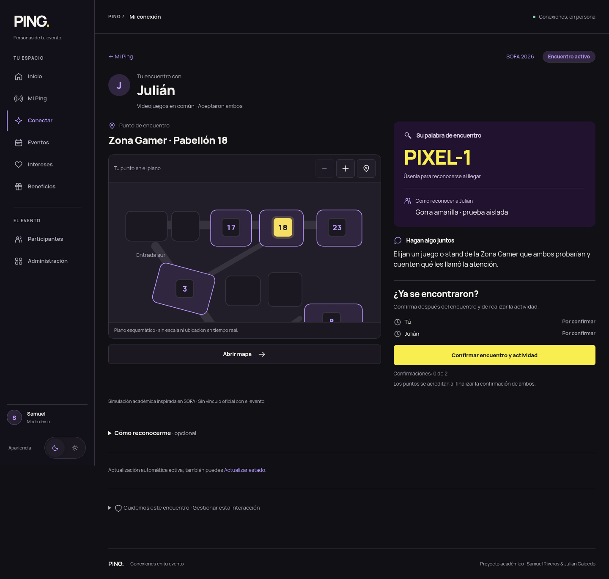
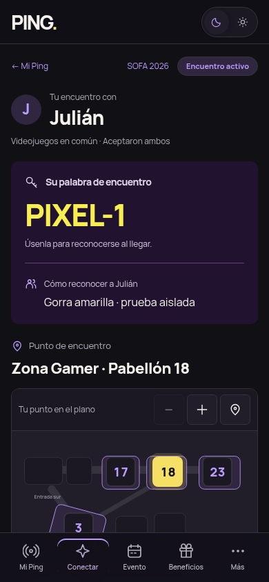
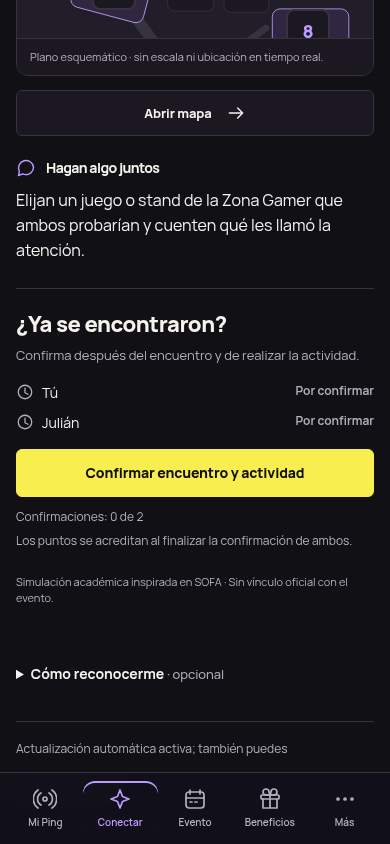

# Encuentro ACTIVE — Festival Social integrado

Instrucción explícita de **Samuel**, 2026-10-16, DEC-032. Sin atribuir aprobación a Julián. Issue asociado: [#14](https://github.com/Samge34c/PING/issues/14), sin declararlo completado; se conservan las reglas de confirmación del MVP.

Base de esta tarea: `55bb83162b01e3131732716c85796ff668ce145b`. Rama propia `feature/active-festival-social`; PR en borrador hacia `reconstruction/festival-social`. PR #24 y el Hub no se modifican. Sin merge, force-push ni main.

## Antes y después

Antes: bloques verticales de punto/minimapa, palabra y actividad; el botón quedaba después del recorrido completo. Después: cabecera compacta; plano funcional y punto a la izquierda; palabra, pista autorizada, actividad y confirmación a la derecha. Móvil/tablet usa el orden real del DOM: palabra/pista → lugar/plano compacto → actividad → confirmación. No se fuerza todo a un viewport, no hay hero ni ilustración nueva y la confirmación no es fija/sticky.

La palabra sigue siendo la asignada por el backend y la pista su complemento opcional. El botón conserva «Confirmar encuentro y actividad» y explica que se usa después de ambas cosas. La espera de la otra persona se distingue de una finalización; Saga pendiente mantiene su aviso y reintento, sin aparentar puntos definitivos.

## Archivos de aplicación y contratos

| Archivo | Cambio |
| --- | --- |
| `templates/demo/match.html` | Monta el fragmento de ACTIVE y su script, manteniendo atributos live, editor, seguridad y estados adyacentes. |
| `templates/demo/active-mission.html` | Composición operativa, palabra/pista, punto, mapa interactivo, actividad y progreso bilateral. |
| `static/js/active-map.js` | Zoom y centrado del plano inline. Los enlaces navegan al mapa real; no se reescribe la URL del encuentro. |
| `static/css/brand.css` | Sección DEC-032 con estilos exclusivos de ACTIVE y reserva de foco junto a la barra inferior. |
| `EventExperienceTests.java` | Cuatro casos adicionales para formularios bilaterales, Saga pendiente y los dos IDs del pabellón 17. Protecciones anteriores intactas. |

Java de producción, reglas, permisos, migraciones, persistencia y datos de demo no cambian. Tampoco `live.js`, `recognition-hint.js`, `ui.js`, navegación compartida, Home, Mi Ping, Beneficios, Hub ni mapa externo. El plano reutiliza `experience/venue.html`, iconos y variables locales. Tecnología y Música comparten pabellón físico 17, pero los enlaces conservan respectivamente `technology` y `stage`, con el matchId correcto para regresar. Eventos sin catálogo conservan su punto, palabra, actividad y confirmación sin un mapa inventado.

## Verificaciones actuales

- Java 21 / Maven Wrapper, Linux: `clean verify`, **154 pruebas, 0 fallos, 0 errores, 0 omitidas**; JAR generado. Incluye EventExperienceTests (28), RecognitionHintTests (7), SofaDemoTests y pruebas Saga existentes. Los 150 anteriores son antecedentes; este resultado es de esta implementación.
- Focalizadas previas: EventExperienceTests + RecognitionHintTests, 35 aprobadas. No se repitieron después por documentación.
- Chromium/aplicación Spring real con H2 aislado: **104 combinaciones**, 13 variantes × 1440/800/390/360 × claro/oscuro. Ambas personas antes de confirmar, espera propia/ajena, pista presente/ausente, alias y pista largos, Gamer/Tecnología/Música/Cosplay, Saga pendiente, OFFERED/COMPLETED/CANCELLED, pausa y evento sin plano.
- Cinco escenarios llegaron a ACTIVE usando **dos sesiones y ambos formularios HTTP de aceptación**. No se fabricó ACTIVE en HTML. El caso Saga pendiente se preparó con pasos durables reales en H2, sin introducir rutas o fallos en producción.
- Flujo por interfaz: primera confirmación sin finalización, segunda confirmación y +10 para cada persona, POST repetido sin segundo crédito. Reintento de Saga pendiente completa mediante el endpoint existente.
- Dos clics rápidos: **un solo POST**; saldo unilateral **0**. Pista ajena aparece/desaparece por actualización real, borrador propio se conserva ante cambio de estado y Cancelar borrador permite refrescar. Sin fuga al Hub.
- Plano: zoom, centrado, teclado, enlaces y retorno. Identificador asignado conservado entre las zonas del pabellón 17. Sin errores JavaScript observados ni overflow horizontal; controles principales y recorrido de foco comprobados. Footer alcanzable sobre la barra móvil.
- Ampliación **CSS** al 200% en 800×1000: sin overflow horizontal y botón enfocado completo por encima de la barra inferior. Es una prueba de magnificación/reflujo; no sustituye zoom nativo ni pruebas en dispositivo.
- MySQL existente: **8 combinaciones** de tamaños/temas, solo lectura del encuentro; firma del estado, palabra, punto y 0/2 se conservaron. Único POST de selección de sesión demo; ningún POST de aceptación/confirmación sobre esos datos. Flyway validó V1–V12 sin migración nueva. Solo se recargó PING para las plantillas cacheadas, no MySQL. Hub smoke HTTP 200 y composición conservada.
- `git diff --check` y ausencia de cambios fuera del alcance revisados. No se versionan sesiones, credenciales, logs privados ni datos MySQL.

## Capturas reales, datos aislados

Estas capturas son de la aplicación ejecutándose, con fixtures ficticios de prueba y ACTIVE obtenido mediante aceptación bilateral real. No son una propuesta HTML independiente ni capturas de pistas privadas de la demo MySQL existente.

## Skills y revisión

Lectura manual de skills de proyecto; no se presupone descubrimiento automático ni se instaló nada. ping-efficient-work acotó lecturas y reutilizó servicios/harness; Redesign adaptó jerarquía al modo operativo; Impeccable se aplicó en revisión manual de imágenes, con un context y un detector, sin flujo formal de critique/subagentes y con hooks desactivados. UI UX Pro Max se consultó solo para foco no oculto: recomendación AAA mejorada, sin presentarla como requisito AA. verification-before-completion exigió evidencia actual. systematic-debugging aisló una medición anticipada del scroll suave del navegador: el verificador ahora espera la condición de foco estabilizado.

El detector salió 2 con tres avisos: jerarquía plana al leer la plantilla sin resolver fragmentos/CSS, cadencia de textos preexistentes de otros estados y un borde antiguo en brand.css:1076. No se cambiaron instrucciones funcionales ni otra pantalla para silenciarlo. La composición y tipografía se revisaron renderizadas; el detector no constituye aprobación visual ni auditoría completa de accesibilidad.

## Continuidad y pendientes

Copia `/workspace/work/ping-verificacion-final-mvp`. PING sigue en `127.0.0.1:8080`, perfil mysql, configuración privada fuera del repositorio en `/workspace/work/ping-runtime/`. La instancia H2 temporal está cerrada. Scripts/logs/evidencia adicional en `/workspace/work/ping-active-20261016/`, locales; capturas MySQL y anteriores con pistas quedan allí privadas y no se publican.

Sin cambios de código tras las verificaciones; después solo se añadieron documentación y copias de las capturas aisladas. Pendiente: revisión humana de la PR; Windows, Safari/dispositivo real y zoom nativo no ejecutados aquí. El SHA local/remoto se contrasta en la entrega y Git. El trabajo y ZIP de la tarea anterior siguen sin recuperarse.
