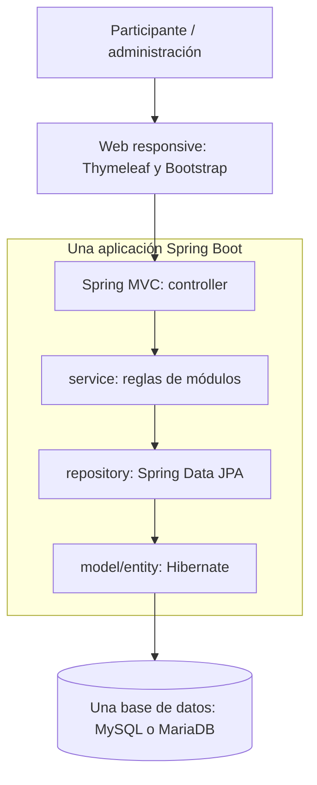

# Arquitectura prevista

Diseño conceptual para pre-implementación basado en [PREDEV, §§14–15](PING_PREDEV_v1.1.md). No representa componentes ya construidos.

Una aplicación web Spring Boot y una base de datos MySQL **o** MariaDB. Monolito modular; Spring MVC y Thymeleaf renderizan la interfaz responsive con Bootstrap/JavaScript básico. Spring Data JPA/Hibernate gestiona persistencia.

## Módulos conceptuales

| Módulo | Responsabilidad prevista |
| --- | --- |
| Event | Evento y apertura, pausa, cierre |
| Participant | Alias, pertenencia al evento y disponibilidad |
| Interest | Catálogo y selección de intereses |
| Matching | Afinidad, espera, propuestas, aceptación, encuentro y cancelación; respetar bloqueos |
| Activity | Catálogo breve y alternativa del anfitrión |
| Reward | Puntos y beneficio/canje opcional; estados de entrega |
| Feedback | Opinión opcional sin recompensa |
| Administration | Gestión básica, reportes/bloqueos y métricas |

Capas sugeridas: `controller` (HTTP), `service` (reglas), `repository` (persistencia), `model/entity` (dominio), `dto` (datos de entrada/salida), `config` (configuración). La organización de paquetes se fijará al crear el proyecto; no es obligatorio duplicar carpetas globales y por módulo.

La aplicación deberá proteger las reglas de un match activo, aceptación y confirmación bilaterales y acreditación coherente de puntos. La estrategia concreta de transacciones y concurrencia deberá definirse y probarse en su Issue; no está decidida aquí.

## Pendiente de bootstrap

Versiones compatibles de Java, Spring Boot, Maven y motor SQL; elección MySQL/MariaDB; identificadores del proyecto; configuración local sin secretos versionados. Ver [decisiones y pendientes](DECISION_LOG.md).

No requiere microservicios, Redis, RabbitMQ, Kubernetes, Docker obligatorio ni integración Tiked. Una modificación arquitectónica requiere decisión humana documentada.
