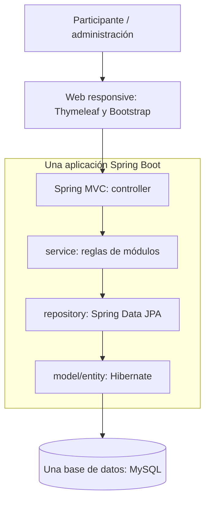

# Arquitectura prevista

Diseño conceptual para pre-implementación basado en [PREDEV, §§14–15](PING_PREDEV_v1.1.md). La rama `feature/mvp-demo` implementa Event, Participant, Interest y Matching hasta confirmación/puntos/feedback; actividades en un catálogo Java predefinido. Canje, actividad del anfitrión y bloqueo/reporte general siguen conceptuales.

Una aplicación web Spring Boot y una base de datos MySQL **8.4.11 LTS**. Monolito modular; Spring MVC y Thymeleaf renderizan la interfaz responsive con Bootstrap/JavaScript básico. Spring Data JPA/Hibernate gestiona persistencia.

## Módulos conceptuales

| Módulo | Responsabilidad prevista |
| --- | --- |
| Event | Evento y apertura, pausa, cierre |
| Participant | Alias, pertenencia al evento y disponibilidad |
| Interest | Catálogo y selección de intereses |
| Matching | Afinidad, espera, propuestas, aceptación, encuentro y cancelación; respetar bloqueos |
| Activity | Catálogo breve y alternativa del anfitrión |
| Reward | Puntos y beneficio/canje opcional; estados de entrega |
| Feedback | Opinión opcional sin recompensa |
| Administration | Gestión básica, reportes/bloqueos y métricas |

Capas sugeridas: `controller` (HTTP), `service` (reglas), `repository` (persistencia), `model/entity` (dominio), `dto` (datos de entrada/salida), `config` (configuración). La organización de paquetes se fijará al crear el proyecto; no es obligatorio duplicar carpetas globales y por módulo.

La aplicación deberá proteger las reglas de un match activo, aceptación y confirmación bilaterales y acreditación coherente de puntos. DEC-019 fija transacciones de escritura READ_COMMITTED, bloqueo pesimista de evento y reservas persistentes con PK por participante para OFFERED/ACTIVE. Completar y acreditar ambos saldos ocurre en la misma transacción, con reintentos idempotentes.

## Bootstrap técnico confirmado

Java 21 y Spring Boot 4.1.1; Maven 3.9.16 con Wrapper 3.3.4; MySQL 8.4.11 LTS. Proyecto `com.ping:ping:0.0.1-SNAPSHOT`, paquete `com.ping`, JAR. La base y el flujo principal existen en ramas apiladas; el catálogo de actividades y puntos se implementan dentro del flujo de match sin infraestructura adicional. Perfil `bootstrap` para arranque web sin persistencia; perfil predeterminado `mysql` con variables de entorno, Flyway y DDL `validate`. Ver [DEC-015](DECISION_LOG.md#dec-015--bootstrap-técnico-spring-boot) y [desarrollo local](../README.md#desarrollo-local).

No requiere microservicios, Redis, RabbitMQ, Kubernetes, Docker obligatorio ni integración Tiked. Una modificación arquitectónica requiere decisión humana documentada.
