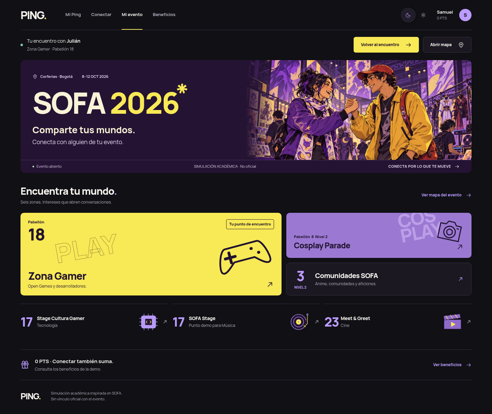
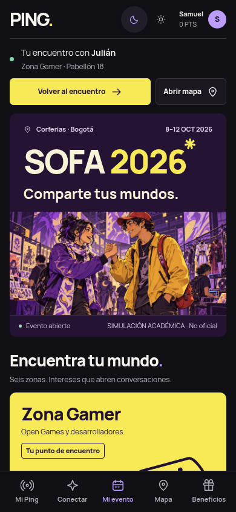

# Hub SOFA integrado — Festival Social

Autorización: Samuel, 2026-10-16, DEC-031. Referencia: segunda composición local aprobada. Asociado al [Issue #14](https://github.com/Samge34c/PING/issues/14), que sigue abierto. No se atribuye aprobación a Julián.

## Implementación y límites

- `/events/{id}/hub`: mensaje/escena social, siguiente acción contextual, seis zonas con destinos reales, alias/saldo de la sesión válida del evento.
- OFFERED muestra «Ver propuesta» sin punto aceptado. ACTIVE muestra retorno y zona derivada de `experience.atPoint(currentMatch.meetingPoint)`. El marcador compara IDs: `technology` y `stage` comparten el pabellón 17. Un punto no catalogado conserva el encuentro sin inventar zona.
- OPEN respeta disponibilidad. PAUSED/CLOSED permiten explorar y volver a ACTIVE, sin ofrecer búsqueda nueva. Invitado/sesión ajena conservan entrada y exploración. Formularios originales mantienen CSRF/versión. Sin pista privada ajena, reglas nuevas o datos de actividad inventados.
- Cabecera y barra móvil en `experience/hub-fragments.html`, exclusivas del Hub. Las otras pantallas mantienen `fragments/layout.html`. Java de producción, catálogo, JS compartido, migraciones y reglas no cambian.

Diferencias frente al prototipo: componentes reales del selector de tema e iconos existentes; alias/saldo/estado dinámicos; nombre de Gamer al principio en móvil; se omite allí el segundo enlace al mapa porque el acceso contextual sigue arriba; sin animación de entrada heredada del main. Los badges existentes se muestran únicamente cuando corresponden.

El arte original fue reutilizado, no regenerado: WebP 1536×1024, 319.502 bytes frente a PNG de 2.704.697 bytes. Procedencia y hashes en [HUB_ART_PROVENANCE.json](HUB_ART_PROVENANCE.json); prompt original en [HUB_ILLUSTRATION_PROMPT.txt](HUB_ILLUSTRATION_PROMPT.txt). No es arte oficial ni registro de asistentes reales.

## Evidencia actual (2026-10-16)

| Control | Resultado y alcance |
| --- | --- |
| Maven Wrapper, Java 21, `clean verify` | 150 pruebas, 0 fallos, 0 errores, 0 omitidas; JAR generado. Incluye 24 EventExperienceTests y 9 SofaDemoTests. H2 de pruebas aislado. |
| Chromium, aplicación Spring real con perfil test | 144 combinaciones: 18 estados × 1440/800/390/360 px × oscuro/claro. Invitado, sesión ajena, disponible/no disponible, OFFERED, seis zonas ACTIVE, PAUSED/CLOSED con/sin ACTIVE y saldo real no cero. |
| Interacción por formularios reales en H2 aislado | Disponibilidad → propuesta → aceptación de ambos → mapa → palabra/actividad → confirmación de ambos → 10 PTS → beneficios. Sin alterar demo MySQL. |
| Controles del Hub | Enlaces a seis zonas/mapa HTTP 200, foco visible, controles de navegación/acción ≥44 px, ausencia de overflow, nombre Gamer temprano en móvil, sin solapamiento de marcador/título, footer alcanzable sobre la barra inferior. Selector de tema y movimiento reducido revisados. |
| MySQL existente, perfil mysql | 16 combinaciones de participante/invitado, cuatro anchos y ambos temas. Samuel conserva ACTIVE con Julián en Gamer, saldo 0 PTS. Solo se seleccionó la sesión demo; sin modificar registros para las capturas. |
| Flyway MySQL | V1–V12 validadas; esquema en versión 12, sin migración necesaria. MySQL no se reinició. PING se recargó una vez para reemplazar las plantillas cacheadas. |
| Privacidad | Protecciones anteriores conservadas; pruebas de Hub sin pistas en OFFERED/ACTIVE, historia y listados siguen cubiertas. Ninguna sesión/cookie/credencial forma parte del commit. |
| Diff | Sin cambios en Java de producción, migraciones, fragmentos/nav compartidos, JS ni configuración de hooks. `git diff --check` correcto. |

Capturas reales de la demo MySQL:

## Skills y revisión

Lectura manual local desde `docs/SKILLS_PING.md`; no se supone descubrimiento automático y no se instaló nada.

- ping-efficient-work: reutilización de prototipo, recursos, servicios y evidencias acotadas.
- redesign-existing-projects: composición aprobada adaptada al stack y a los estados reales.
- impeccable: un `context`, revisión manual de capturas y pulido; un detector mecánico. Hooks desactivados. No se ejecutó el flujo formal de critique ni subagentes.
- systematic-debugging: selector/ejecutable del verificador, caché de plantillas, herencia de color y parámetros vacíos diagnosticados con evidencia.
- verification-before-completion: pruebas y evidencia nuevas antes de commit. UI UX Pro Max no se invocó: no quedó una duda que justificara otra consulta.

El detector salió 2 con tres avisos: no reconoce `th:src`; calcula h1/h2 como 16 px al analizar la plantilla aislada; y detecta un borde antiguo de otra pantalla en brand.css:1076. Evidencia renderizada: imagen válida 1536×1024, h1 86 px, h2 29 px y cuerpo 16 px a 1440. No se modificó otra pantalla para silenciarlo. El detector no sustituye la revisión visual.

## Continuidad

Copia `/workspace/work/ping-verificacion-final-mvp`, rama `reconstruction/festival-social`, base de esta tarea `9b063d06d2f1506e45d38a4e96c247263aa8c810`. Arranque y credenciales locales siguen fuera del repositorio en `/workspace/work/ping-runtime/`; PING en `http://127.0.0.1:8080/events/1/hub`, perfil mysql. La instancia H2 temporal se cerró. Logs, scripts de comprobación y capturas adicionales en `/workspace/work/ping-hub-integration-20261016/`, locales.

No se modificó código después de la verificación; los cambios posteriores son esta documentación y la copia de capturas. Windows/Safari no se ejecutaron aquí. Pendiente: revisión del cambio antes de cualquier integración; sin merge ni main. El trabajo y ZIP de la tarea anterior siguen sin recuperarse. El SHA de publicación se comprueba en Git y en la entrega, no se inventa en esta nota.
