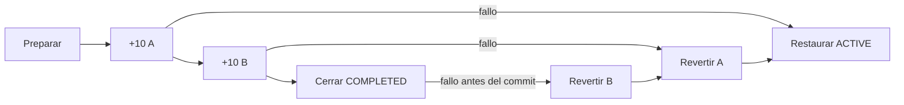

# Saga de finalización de Ping

Ping sigue siendo un monolito modular con una base MySQL. Antes, confirmar por ambos, completar y acreditar los dos saldos ocurría en una sola transacción ACID: suficiente para el MVP, pero no demostraba Saga. El requisito académico se implementa como **orquestación local**: `MatchCompletionSaga` controla acciones y compensaciones; cada método de `MatchCompletionSagaSteps` usa una transacción **REQUIRES_NEW** independiente. Coreografía local sería posible, pero repartiría el avance entre manejadores de eventos; el coordinador hace más claros el orden, los fallos y las pruebas. No hay broker ni microservicios.

## Pasos y compensación

| Paso | Acción y resultado confirmado | Fallo posible | Compensación |
| --- | --- | --- | --- |
| 1. Preparar | Ambas confirmaciones; reserva finalización, `MATCH_PREPARED` | Validación/escritura SQL | Rollback local si no se confirmó; si ya se confirmó, restaurar ACTIVE y deshacer la última confirmación |
| 2. Recompensa A | +10 a A y recibo `first_granted`, `FIRST_REWARD_GRANTED` | Desbordamiento o fallo SQL | Restar exactamente esos 10 si el recibo existe |
| 3. Recompensa B | +10 a B y recibo `second_granted`, `SECOND_REWARD_GRANTED` | Desbordamiento o fallo SQL | Restar exactamente esos 10 si el recibo existe; después compensar A |
| 4. Cerrar | Match `COMPLETED`, reiniciar espera, liberar reservas y Saga `COMPLETED` | Escritura SQL | Si el cierre no se confirmó, compensar B→A→preparación; si quedó confirmado, no revertir |

El match **permanece ACTIVE con `completion_pending=true` hasta el cierre**. No se expone COMPLETED ni se admite feedback anticipado. Se impide cancelar o buscar otro match durante la operación. Al compensar conserva punto/palabra/actividad y reserva; se revierte la confirmación que disparó la Saga, para que esa persona pueda volver a confirmar. El saldo previo se conserva y nunca se fuerza negativo. Feedback queda fuera de la Saga: es posterior, opcional y sin recompensa.



V8 añade `completion_pending`, una Saga por match y una traza con clave única `(match, intento, acción)`. Crédito/recibo/traza se confirman juntos en cada paso; reversión/recibo/traza también. Reintentos no suman ni descuentan dos veces. Un intento compensado reutiliza el registro de Saga y aumenta su número, sin duplicar el match. Matches COMPLETED anteriores a V8 continúan idempotentes y no reciben puntos adicionales.

## Recuperación y límites

La aplicación actual tiene **un único proceso**. Su coordinador sincroniza ejecuciones; cada paso bloquea el evento en SQL. No hay una transacción externa que encierre todos los pasos. Si el proceso se detiene entre commits, el último estado persiste y `recoverPending()` lo retoma al iniciar. También se recupera al reintentar confirmar. Si falla una compensación queda `FAILED`, con recibos y reservas intactos; la siguiente recuperación solo revierte lo pendiente. Si la BD no responde tampoco puede compensarse: se conserva el último checkpoint confirmado hasta recuperar SQL.

Los créditos intermedios son observables: consistencia eventual del proceso, no atomicidad global. El canje está prohibido mientras exista finalización pendiente; comparte el bloqueo por evento con los pasos, evitando gastar créditos compensables. Varias réplicas requerirían propiedad/lease durable del coordinador; esta implementación no promete coordinarlas.

## CAP / CA / CP

**CAP no clasifica estrictamente este despliegue como CA/CP/AP**: no se ha construido un almacenamiento replicado con protocolo de consenso ni una arquitectura distribuida nueva. ACID local y Saga no equivalen a consistencia linealizable distribuida. Una partición es una interrupción de comunicación entre nodos; no es simplemente una excepción de negocio. Si Ping pierde acceso a MySQL, rechaza escrituras y no inventa saldos. Saga no proporciona por sí misma tolerancia a particiones.

Si la consigna obliga CA o CP, puede decirse, con esta limitación:

> «CP es la analogía más cercana a nuestra política ante pérdida del enlace con MySQL: preferimos suspender escrituras antes que inventar datos.
> Ping sigue siendo un monolito con una sola base; no es una clasificación CAP formal de un sistema replicado.
> Cada paso es ACID, pero la Saga completa usa compensaciones y consistencia eventual.
> Saga coordina fallos del proceso, no crea tolerancia a particiones.»

## Demostración sin infraestructura adicional

- **Normal:** Samuel/Julián aceptan y confirman desde las dos sesiones habituales: match COMPLETED y +10 a cada uno. La interfaz no añade controles de fallo.
- **Fallo:** ejecutar desde IntelliJ el test `failureAfterFirstCommittedCreditCompensatesWithoutErasingPreviousBalance`, o:

```sh
./mvnw -Dtest=MatchCompletionSagaTests#failureAfterFirstCommittedCreditCompensatesWithoutErasingPreviousBalance test
```

En Windows usar `mvnw.cmd`. El test usa H2 únicamente en test y aplica V1–V8; no requiere MySQL. Empieza con saldos A=40/B=70, verifica desde otra transacción A=50 ya confirmado, inyecta fallo **solo mediante Mockito en tests** antes de B y muestra `COMPENSATED`, A=40/B=70 y traza `PREPARE_MATCH → GRANT_FIRST → REVERSE_FIRST → RESTORE_MATCH`. No se usa un rollback global ni se agrega un interruptor de fallos en producción. Los demás tests cubren cierre fallido, compensación fallida, recuperación, reintento y concurrencia.
