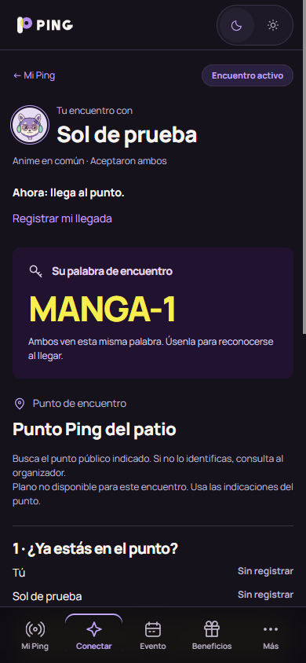
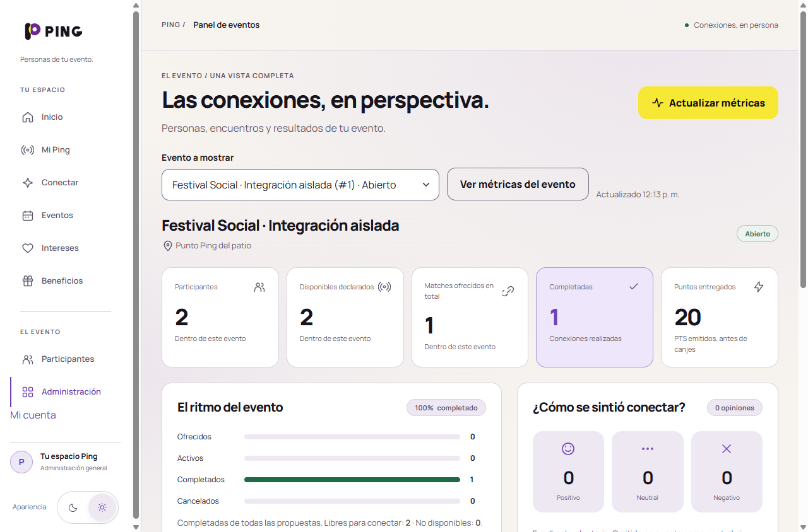

# Rendimiento integrado sobre la entrega reciente · 29 octubre 2026

Implementación local terminada y verificable, sin commit ni publicación. Base/HEAD `3a528cab9312cdb314ac40252bd7ba3782afd0b0` de `deploy/render-demo`, rama `perf/closure-current`. Conserva Google (PR #59), acceso continuo (PR #60) y correos HTML (PR #61). Procedencia de las optimizaciones: [PR #58, `b54aaae`](https://github.com/Samge34c/PING/pull/58), sobre la base histórica `40f2247`. Las referencias remotas se contrastaron antes de editar y no habían avanzado.

El árbol está sin commit por instrucción del encargo. Versión exacta de aplicación, pruebas y generadores: [source-manifest.json](source-manifest.json), SHA-256 **`c1815afd3ee79359a4446d3e87a1aa5759141167c3b15278242e06627f672fcc`**. JAR final SHA-256 **`636b4ea85550ccfed8f5d4c1d49c1e1581a661e8787c5bad7e6e89845bbec250`**. La documentación y las capturas posteriores no cambiaron esas fuentes. Los 499 recursos empaquetados coinciden byte a byte con sus fuentes; el JAR no contiene la fixture de seguridad de pruebas.

## Qué se recuperó

- `AuthSupport` reutiliza una lectura fresca exclusivamente en la misma petición, autenticación y sesión/ID de sesión. Reemplazar autenticación, rotar/reemplazar sesión o salir y volver a entrar invalida esa reutilización. Fuera de petición no hay caché; la siguiente petición privada vuelve a observar roles y `auth_epoch`.
- `AccessPolicy` evita consultar cuentas para `ResourceHttpRequestHandler`; la cadena Spring Security sigue ejecutándose. Planos, pistas, códigos y recibos son controladores privados y conservan sus comprobaciones.
- Conectar consulta únicamente el ID OFFERED/ACTIVE más reciente. Sin encuentro mantiene participante, evento, experiencia, `held` y firma; no crea historial ni formularios que la pantalla no consume. Mi Ping/historial mantienen sus datos.
- Beneficios filtra activos locales/genéricos en SQL y agrupa indicadores de completada/pendiente para GET. Conserva orden local antes de genérico e ID; no limita a dos beneficios. El POST sigue leyendo estado fresco bajo bloqueo antes de cobrar y conserva `requestKey`, costes y snapshots.
- ACTIVE usa una única lectura autorizada de pista para texto y revisión; la firma usa el encuentro/evento ya leídos. La autorización sigue exigiendo pertenencia, ACTIVE y aceptación bilateral.
- Bootstrap 5.3.8 reducido **regenerado con templates, JS y Java actuales**; original/licencia conservados. Manrope núcleo/extra con `unicode-range` y precarga coherente, WebP 768/1152/original con `srcset`/`sizes`, selector compacto y contraste acotado de `.am-location .am-word-help`.

`v2.css`, clases de Google, confirmación de cuenta, «Revisa tu correo» y Java de Google/acceso continuo/correos permanecen idénticos a la entrega base. No se sustituyeron carpetas completas. Huellas/caché inmutable, compresión selectiva, polling serial/visibilidad y QR bajo demanda ya existían y no se reconstruyeron. Sin migraciones, índices, servicios, dependencias de aplicación, caché de permisos/sesión, compresión privada ni rediseño. Las variantes reutilizan los recursos originales verificados; no se generó arte nuevo ni se incluyeron los recursos en curso de Claude.

## Comparación actual sobre escenarios equivalentes

Misma entrega base y mismos fixtures H2 aislados: dos cuentas, 48 encuentros terminales adicionales y 24 beneficios ajenos. Conteo JDBC SELECT y filas **consumidas** por ResultSet; no paquetes de red ni filas examinadas internamente por MySQL.

| Escenario | SELECT antes → después | Filas de encuentros antes → después |
|---|---:|---:|
| Conectar OFFERED, ambas orientaciones | 9 → 3 | 49 → 1 |
| Conectar ACTIVE, ambas orientaciones | 10 → 3 | 49 → 1 |
| Conectar sin encuentro | 9 → 5 | 49 → 0 |
| Beneficios SOFA | 10 → 7 | 98 → 1 |
| Página ACTIVE con pista | 20 → 14 | 5 → 3 |
| Predicado pendiente | 1 → 1 | 49 → 1 |

Beneficios materializa 26 → 2 filas en ese fixture. El recorrido independiente muestra **cuatro beneficios locales más uno genérico**, sin el catálogo ajeno. Pista: 2 → 1 llamadas autorizadas. Lecturas frescas de cuenta: Inicio 2 → 1, Mi cuenta 3 → 1, `/me/state` 1 → 1 y cada CSS/JS/favicon público 1 → 0. No reutilizar las cifras SQL de informes históricos como mediciones de esta entrega.

| Archivo | Bytes antes/original | Bytes integrado |
|---|---:|---:|
| Bootstrap servido | 232116 | 32850 |
| Fuente precargada | 164700 | 88704 |
| Imagen Inicio, móvil densidad 2 | 319502 | 115238 |
| Imagen Inicio, móvil densidad 3 | 319502 | 207174 |

Bootstrap gzip nivel 9: 31008 → 7300 bytes; fuente precargada: 68008 → 36742. Son tamaños reproducibles, no tiempos de carga. WebP no se comprime en el servidor. Escritorio densidad 2 conserva el original. Selector: comparación semántica del template con la base, ignorando comentarios y espacios entre etiquetas, idéntica; campos, IDs, valores y orden se conservan.

## Verificación de este árbol

Entorno Windows, Temurin 21.0.12.1, Maven 3.9.16, H2 efímero, correo loopback/in-memory. Sin perfiles `mysql`/`render` ni Aiven. Se empleó el agente Mockito local sin modificar el POM.

```powershell
.\mvnw.cmd --batch-mode --no-transfer-progress '-Dspring.profiles.default=test' '-DargLine=-javaagent:C:/Users/river/.m2/repository/org/mockito/mockito-core/5.23.0/mockito-core-5.23.0.jar' clean verify
python docs/performance/frontend/tools/bootstrap_subset.py --check
```

- Referencia antes del cambio: 8 pruebas, 7 fallos esperados de rendimiento, 0 errores. Las comprobaciones del agregado nuevo se añadieron después; no se atribuyen al antes.
- Backend dirigido: 115 pruebas, 0 fallos/errores/omitidas, incluidas OAuth, correo, permisos, pistas, polling, canje, verificación y Saga.
- **Suite final una sola vez: 358 pruebas, 0 fallos, 0 errores, 0 omitidas; BUILD SUCCESS**, 2:07, finalizada `2026-10-29 12:06:57 -05:00`, JAR generado. Los XML de Surefire confirman el mismo total. No se suma a la ejecución dirigida ni a las 338 históricas.
- Tras la interrupción se revisaron status, timestamps y escrituras UTF-8; las fuentes eran las mismas. Se reutilizó el resultado completo. Solo cambiaron auxiliares/evidencia/documentación después.
- Bootstrap `--check` correcto tras regenerar. Comparación real de estilos computados con Bootstrap completo en formulario de beneficio, avatar y error de acceso; foco visible. Cobertura de clases actuales en `FrontendBundleTests`, incluidas las nuevas pantallas de acceso.
- Unión de glifos núcleo/extra y ejes variables iguales al original. El navegador carga extra al representar «Жệ»; precarga/CSS comparten la huella del núcleo. Imágenes 3:2 y selección real 390×3→1152, 360×2→768, 1280×2→original.
- Navegador con JavaScript de página deshabilitado: 264 opciones visibles, etiquetas/checkbox nativos, POST real, retorno a Mi Ping y selección persistida. Guardar alcanzable por hit-test por encima de la barra inferior.

Dos personas ficticias completaron evento elegido → registro/contraseña/verificación por correo MIME local → avatar V3/intereses → disponibilidad/propuesta → aceptación bilateral → ambas llegadas → códigos personales y verificación cruzada → ambas confirmaciones → 10 puntos por persona. Confirmar antes se rechaza; primera confirmación no acredita. Reintentos de alta/llegada/verificación/confirmación no duplican. Canje 5 repetido devuelve el mismo recibo y saldo 5, recibo ajeno se rechaza sin datos, otra cuenta autorizada valida/entrega y su reintento conserva un solo débito. Polling sin códigos personales y respuestas privadas `no-store`.

Google, enlace seguro por proveedor+subject, cambio de sesión, continuación hacia evento elegido, recuperación/revocación y correos HTML se comprueban con sus pruebas actuales. Consentimiento real de Google no se simuló como una prueba externa. Avatares V3, planos, snapshots, políticas históricas ACTIVE y Saga están cubiertos por la suite final.

Incidentes exclusivamente de auxiliares, conservados en logs: intento antes de terminar el arranque; URL absoluta concatenada para una captura después de completar la entrega; selector del botón oculto Revisar y pulsación antes de terminar scroll suave; lectura diagnóstica del formulario anterior tras navegar. Se corrigieron y se reanudó lo pendiente sin cambiar PING ni repetir la suite. El consolidador necesitó leer los logs UTF-16 emitidos por PowerShell; fuentes y auxiliares escritos como UTF-8 estaban completos.

## Capturas examinadas

Primero móvil390, referencia principal:



[360 claro](capturas/active-360-claro.png) · [Intereses390](capturas/intereses-390-oscuro.png) · [Intereses360](capturas/intereses-360-claro.png) · [Avatar](capturas/avatar-390-oscuro.png) · [Inicio](capturas/inicio-390-oscuro.png) · [Beneficios](capturas/beneficios-390-oscuro.png) · [Entrega](capturas/entregado-390-oscuro.png).

Después escritorio:



Se entiende persona/estado y siguiente acción; el contenido importante no queda desplazado por decoración ni huecos nuevos. La navegación conserva acceso al contenido y Guardar fue alcanzable al desplazar. Coherencia con Festival Social, controles y ambos temas conservados. La ayuda de ubicación sin plano resulta legible; contraste del CSS cargado 9,36:1 oscuro / 6,34:1 claro. Ese cálculo aplicó el selector real a un elemento temporal sin datos en el navegador; las capturas ACTIVE son de un encuentro real del ensayo antes de emitir códigos privados. No se publican cookies, contraseñas, QR personales ni correos de verificación. Chrome emulado no es un iPhone físico.

## Continuidad y límites

[Handoff de archivos y siguiente paso para Claude](../../handoffs/CIERRE_RENDIMIENTO.md). [Evidencia sanitizada](evidence.json), con hashes de logs, fuentes, JAR y capturas. Auxiliares y logs originales: `C:\Users\river\PING-movil\target\closure-evidence`; buzón/sesiones/datos ficticios privados en la ruta indicada por `private-path.txt`, fuera de Git. No publicar esos directorios. Se detienen solo los procesos locales creados por esta tarea; H2 era efímero.

Quedan externos: medir varias navegaciones autenticadas en Render/Aiven después de un despliegue autorizado, con servicio despierto y mismo teléfono/red/datos; comprobar Safari/iPhone real, cámara, tipografía y respuesta táctil. Suspensión/CPU de Render Free y TLS/red siguen existiendo. No se promete ahorro en segundos a partir de H2 ni se afirma un nuevo ensayo MySQL. **No apuntar Render a la PR #58 histórica ni seguir las instrucciones de despliegue de sus informes antiguos**: omitirían Google/acceso continuo/correos. Este encargo no autoriza publicación ni despliegue; la futura revisión parte de la entrega reciente más este diff local.
