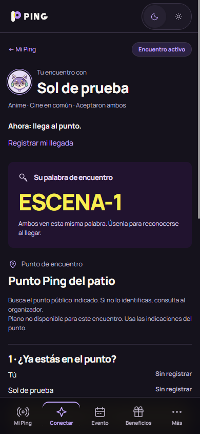
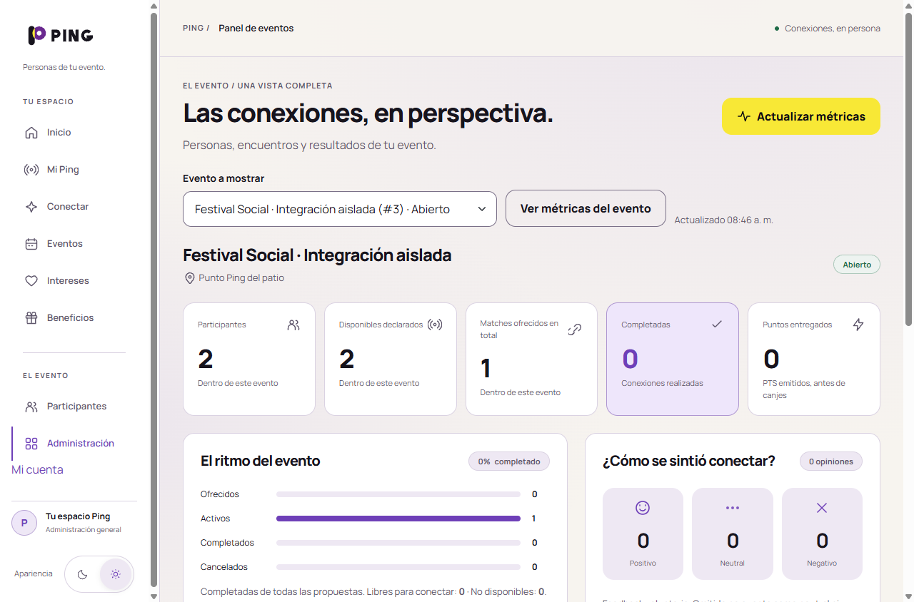

# PING · integración preparada para actualizar Render posteriormente

26 octubre 2026 · [Issue #57](https://github.com/Samge34c/PING/issues/57) · DEC-061.

Rama `perf/integrated-mobile-response`, worktree `C:\Users\river\PING-perf-integrated`. No se desplegó, fusionó ni cerró ninguna PR existente. Las copias `PING-movil`, `PING-perf-backend` y `PING-perf-frontend` conservan sus ramas, HEAD y archivos de trabajo. Los auxiliares de esta tarea y logs están en directorios ignorados de evidencia, no en fuentes.

## Procedencia y cambios integrados

| Conjunto | SHA conservado como ancestro | PR |
|---|---|---|
| Base común: reutilización de cuenta/encuentro por petición | `2346585d0c047ed113686aa7fb15060ffe52f198` | [#53](https://github.com/Samge34c/PING/pull/53) |
| Backend: Conectar, Beneficios y pista autorizada | `66420acf36f742140fddc423e90f281d2a6aa4ed` | [#55](https://github.com/Samge34c/PING/pull/55) |
| Frontend: Bootstrap, fuente, imagen adaptable y marcado de intereses | `4fe3435c2d5fe9776b26bc9efda40fa5941fe0d0` | [#56](https://github.com/Samge34c/PING/pull/56) |

Dos merges sin conflictos desde la base explícita conservan los commits originales: `bcf2fab` (backend) y `20d9aa0` (frontend). El SHA de entrega y su contraste remoto quedan en la PR en borrador hacia `deploy/render-demo`.

- Cuenta fresca reutilizada dentro de la petición/autenticación actual; recursos públicos sin lectura de cuenta. Se siguen comprobando permisos y revocación en la siguiente petición privada.
- `/connect` obtiene el encuentro vigente con consulta acotada; sin encuentro conserva `participant`, `event`, `held`, `experience` y `liveSignature`. Se revisaron también layout, navegación, mensajes y atributos globales de autenticación/CSRF. No vuelven a prepararse historiales o formularios que no consume.
- Beneficios consulta todos los activos locales y genéricos, locales primero y después ID. No hay límite de dos: el recorrido actual muestra **cuatro locales más uno genérico**, excluyendo el evento ajeno. El POST mantiene la comprobación fresca de finalización pendiente bajo bloqueo, coste y clave idempotente.
- ACTIVE reutiliza una sola lectura autorizada de pista para texto/revisión dentro de la petición. Las pruebas actuales comprueban ocultación antes de aceptación bilateral, actualización posterior, aislamiento y cancelación.
- Subconjunto Bootstrap 5.3.8 generado, Manrope núcleo/extra por `unicode-range`, `srcset` de Inicio y fila compacta de intereses. Se conserva el archivo Bootstrap completo como fuente de regeneración. Mantenimiento añadido a [BRAND_GUIDE](../../BRAND_GUIDE.md).
- Única corrección adicional: ayuda de ubicación de ACTIVE sin plano usa el token de texto secundario del tema. El color fijo heredado era demasiado claro en tema claro; no cambia composición ni comportamiento. Contraste observado tras corregir: **9,36:1 oscuro / 6,34:1 claro**.

## Verificación actual, sin sumar resultados históricos

Entorno: Windows, Temurin 21.0.12, Maven Wrapper 3.9.16, H2 efímero. La aplicación para revisión usa perfiles exclusivos `integrated-check` / `integrated-final`, sin `mysql` ni `render`, cuentas ficticias y SMTP loopback. No se usó Aiven, MySQL real ni correo externo.

1. `mvnw.cmd --batch-mode --no-transfer-progress -Dspring.profiles.default=test -DargLine=-javaagent:<mockito-core-5.23.0.jar local> clean verify`: **331 pruebas, 0 fallos, 0 errores, 0 omitidas; BUILD SUCCESS**, 63 s, JAR generado. Fuentes integradas `20d9aa0`.
2. Después de la única corrección visual CSS: `-Dtest=PublicResourceTests,FrontendBundleTests test`: **3 pruebas, 0 fallos/errores/omitidas**. No se repitió toda la suite porque no cambió Java, JS, templates ni reglas.
3. `python docs/performance/frontend/tools/bootstrap_subset.py --check`: correcto antes y después; no fue necesario regenerar. Comparación actual de estilos computados con Bootstrap completo: mismos controles/formularios de administración, selección de avatar, deshabilitado y error de acceso. Foco revisado tras finalizar su transición.
4. `package -DskipTests`: correcto después del CSS; se comprobó que el JAR final contiene exactamente los bytes finales de `brand.css`, Bootstrap reducido y fuente núcleo. No se presenta este empaquetado como otra ejecución de pruebas.
5. `git diff --check`: correcto antes del respaldo. Los controles Java/Linux y herramientas/Windows de GitHub Actions se consultan en la PR de esta rama; su estado no se presume a partir de PR anteriores.

El agente de Mockito se pasa solo al proceso de pruebas, por la restricción local de adjunto; POM y dependencias no cambian. Las 323/330/324 pruebas de PR anteriores y las comparaciones visuales amplias de frontend siguen siendo **evidencia histórica**, no se suman a las 331 actuales. Detalle sanitizado, hashes de logs y paquete: [evidence.json](evidence.json).

## Recorrido dirigido actual y reintentos

Dos sesiones/cuentas nuevas separadas recorrieron código del evento → registro y verificación por correo loopback → alias/avatar V3 → intereses → disponibilidad/búsqueda → propuesta → aceptación de cada persona → llegadas → códigos personales → verificación cruzada → confirmación bilateral → puntos → canje → entrega por una tercera sesión autorizada.

Se guardó y recargó una selección hecha desde el editor real en Chrome, con búsqueda «cine», selección y deselección. Alta repetida conserva dos participantes. La primera aceptación no activa; confirmar antes de llegar/verificar se rechaza. La primera confirmación no acredita. Después de ambas confirmaciones, cada persona tiene 10 puntos; repetir confirmaciones conserva 10. Canje de 5 puntos repetido con la misma clave devuelve el mismo recibo, un solo canje y saldo 5. Repetir verificación, llegada y entrega no duplica efectos. El recibo final muestra «Entregado», sin credencial pendiente ni otro débito. Una sesión ajena recibe 409 sin datos del recibo; los códigos personales no aparecen en la otra sesión ni en `/me/state`.

Las pruebas de seguridad, pistas, permisos, Saga, snapshots e idempotencia incluidas en la suite se ejecutaron sobre la integración actual. No se sustituyen por el conteo de capturas.

Incidentes del auxiliar, sin cambiar PING: PowerShell rechazó cargar un lanzador; se ejecutaron comandos directos sin cambiar su política. El recorrido asumió inicialmente 403 para recibo ajeno; se verificó el 409 real sin exposición y se corrigió la aserción. Hubo una variable faltante en la continuación, una conexión antes de terminar el arranque y un enlace de correo de una instancia anterior; se corrigieron los auxiliares y se completaron únicamente los pasos pendientes. Los logs originales se conservan.

## Revisión visual dirigida

Se reutiliza la comparación amplia de [frontend@4fe3435](../frontend/README.md); no se repitió la auditoría completa. Capturas nuevas de los estados afectados a 390 px, estrechez de 360 px en claro y escritorio 1280 px; errores/foco, formulario de administración y controles dinámicos comprobados. Las capturas son Chrome headless con emulación, **no iPhone/Safari**.

Primero móvil:

[ACTIVE 360 claro](capturas/mobile-360-claro.png) · [Acción de propuesta alcanzable](capturas/propuesta-accion-390-oscuro.png) · [Avatar V3](capturas/avatar-390-oscuro.png) · [Beneficios](capturas/beneficios-390-oscuro.png).

Después escritorio:

La pantalla comunica encuentro/persona, siguiente paso y acción principal. El espacio y la decoración no desplazan la tarea; los cuatro beneficios siguen accesibles al desplazar. La barra inferior mantiene contenido alcanzable: se desplazó y comprobó por hit-test el botón Aceptar por encima de la navegación. Se conserva la identidad Festival Social, ambos temas y V3: pelaje, colores y piezas persistidas, capas traseras/delanteras, orejas sobre bucket y encuadre aprobado al 84 %. El texto de ayuda observado con bajo contraste se corrigió.

Fuentes y huellas: la precarga de Manrope núcleo coincide con la referencia de `brand.css` transformada; al mostrar «Жệ» el navegador carga la parte extra. Los WebP conservan proporción 3:2 (768×512, 1152×768, original 1536×1024). Se examinaron las capturas de Inicio y avatar; la evidencia comparativa previa de calidad sigue enlazada, sin atribuirle una nueva comparación píxel a píxel.

## Mediciones: categorías separadas

**Bytes actuales:** tamaños exactos de CSS, fuentes e imágenes y gzip reproducible se guardan en `evidence.json`. Bootstrap completo ronda 232 KB y el subconjunto 33 KB; núcleo Manrope 88 704 bytes, variantes de Inicio 115 238 / 207 174 bytes. Los tamaños de archivos no son segundos ahorrados.

**SQL actual:** el mismo escenario sintético de las pruebas de backend produjo 3 SELECT en `/connect` OFFERED/ACTIVE, 5 sin encuentro, 7 en Beneficios SOFA y 14 en ACTIVE. Las filas de encuentros consumidas por JDBC fueron 1/0/1/3 respectivamente. Las referencias antes (7/8/7, 9 y 16 SELECT) pertenecen a la evidencia histórica de la base, reutilizada de [backend](../backend/README.md). «2 beneficios» describe su fixture; no limita el catálogo del producto. No son paquetes de red, conexiones físicas ni filas examinadas internamente por MySQL.

**Navegador:** las medianas FCP/LCP y transferencias antes/después siguen en el informe histórico de frontend, con Chrome 390, escala 3, RTT100 ms y CPU×4. Esta integración aporta comprobación funcional/visual; no repite ese benchmark ni lo presenta como una medición nueva.

**Servidor:** no se midió un tiempo de servidor aislado nuevo. `evidence.json` conserva muestras HTTP loopback individuales de la suite, sin DNS/TLS; incluyen cliente, seguridad, aplicación y renderizado de plantilla. No se infiere un porcentaje de velocidad a partir de SQL ni se extrapola a Render/Aiven.

## Riesgos, límites y continuidad

- Pendiente la medición real en Render y en iPhone después de una actualización autorizada. Suspensión, CPU y latencia de Render Free permanecen. No se promete una mejora allí sin medirla.
- Bootstrap requiere regeneración al introducir clases usadas; clases construidas por concatenación requieren ampliar el generador antes. Se conservaron foco, errores y estados usados, con protección y revisión dirigida; no es una garantía para clases futuras.
- Sin migraciones ni transformación de datos respecto de `deploy/render-demo@40f2247`. No se activó compresión HTML/JSON privada, caché personal, más polling, mecanismos de despertar, servicios de pago ni arquitectura nueva. Las propuestas opcionales de frontend (WOFF2, fragmento del editor, compresión de páginas) quedan fuera de esta entrega.
- Logs completos/auxiliares: `C:\Users\river\PING-perf-backend\target\integration-evidence`. Sesiones, buzón y originales de capturas: `C:\Users\river\ping-integrated-evidence`, fuera de Git. No subir esos directorios. La continuidad permanente es este informe, `evidence.json`, DEC-061 y la PR; H2 es efímero y no respalda datos.
- Antes de retomar, leer este informe y comprobar rama/HEAD remoto. Las PR #53/#55/#56 permanecen abiertas sin merge. No comenzar otra ronda de optimizaciones antes de revisar esta integración.

## Actualizar y volver atrás (pasos preparados, no ejecutados)

1. Con autorización posterior de despliegue, anotar el SHA/despliegue actualmente activo en el **servicio existente** de Render. Mantener Auto-Deploy desactivado mientras se elige la versión. Contrastar el SHA remoto de `perf/integrated-mobile-response` con la PR.
2. En ese servicio, seleccionar esta rama y desplegar manualmente el commit verificado. Mantener Free, Dockerfile/contexto, CA, variables y base actuales; no crear servicio ni modificar secretos/datos para esta integración. No se requiere una migración nueva.
3. Tras Live, comprobar login, intereses, Conectar/ACTIVE, llegadas/verificación, puntos y recibo. Medir varias navegaciones con servicio despierto y mismo teléfono/red/datos; separar DNS/TLS, espera de respuesta y FCP/LCP. El reinicio puede exigir iniciar sesión de nuevo.
4. Si hay regresión, volver al despliegue/SHA anotado en el paso 1. La referencia de código anterior verificada es `deploy/render-demo@40f22473d35fbe8164e9ba7ef5e025051858426e`; si el servicio muestra otro SHA, usar el realmente anotado. Seleccionar la rama/commit anterior en el mismo servicio y desplegarlo manualmente. No restaurar ni borrar la base: esta integración no cambia su esquema.
